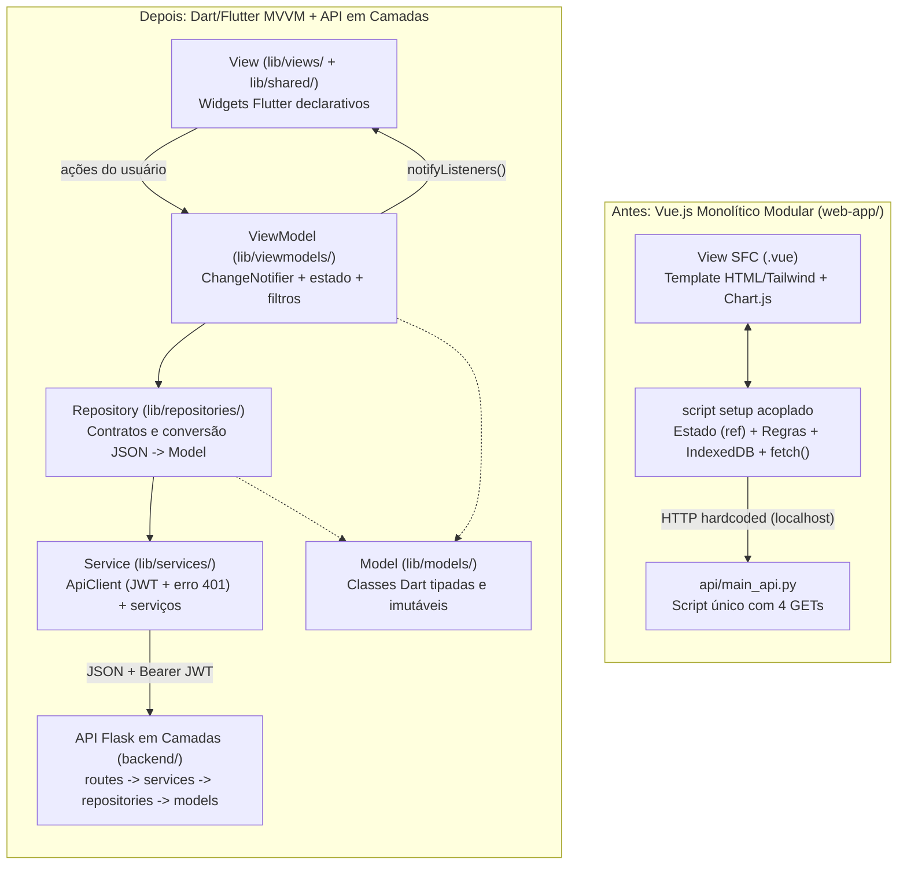
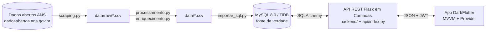
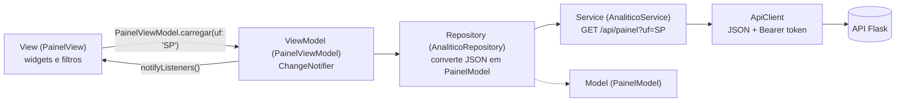

# Intuitive Care — Plataforma de Análise e Gestão de Dados da ANS

Sistema computacional completo composto por **Aplicativo Dart/Flutter (Arquitetura MVVM + Provider, Web Desktop, Responsivo e Mobile)**, **API REST em Python + Flask (Arquitetura em Camadas)**, **Pipeline ETL em Python com dados reais da ANS** e **Banco de Dados Relacional MySQL / TiDB**.

Projeto desenvolvido e migrado para atender às diretrizes da **2ª Avaliação** das disciplinas de **Códigos de Alta Performance (Mobile)** e **Backend Frameworks** — Curso de Graduação em Ciências da Computação (UNINASSAU João Pessoa).

---

## Migração da Arquitetura do Sistema: Vue.js (Monolítica Modular) → Dart (MVVM)

Um dos pilares técnicos deste projeto foi a **reengenharia completa da arquitetura**: o sistema evoluiu de uma **aplicação web em Vue.js organizada como monolito modular** (acoplada a uma API de arquivo único) para uma **arquitetura cliente-servidor desacoplada**, com **frontend em Dart/Flutter estruturado estritamente em MVVM** e **backend REST em Python/Flask estruturado em camadas**.

### 1. Como era antes: Vue.js em Arquitetura Monolítica Modular (`web-app/`)

Na primeira versão do projeto (removida na refatoração estrutural e preservada no histórico Git), o frontend ficava em `web-app/src/` (junto ao protótipo `frontend/index.html`) e seguia um estilo **monolítico modular**:

- **Modularização apenas por páginas/componentes (SFCs):** o código era separado por rotas no `web-app/src/router.js` (`/`, `/dashboard`, `/operadora/:cnpj`) e arquivos `.vue` (`HomeView.vue`, `DashboardView.vue`, `OperadoraDetailsView.vue`, `App.vue`), mas **não possuía divisão interna de camadas**.
- **Concentração de responsabilidades nas Views:** dentro do bloco `<script setup>` de componentes como `DashboardView.vue` e `OperadoraDetailsView.vue`, coexistiam simultaneamente:
  1. Estado local reativo (`ref`, `computed`, `watch`);
  2. Chamadas de rede diretas com URL fixa (`fetch('http://localhost:5000/api/...')`);
  3. Regras de formatação, *debounce*, paginação e agrupamento de despesas por trimestre;
  4. Persistência local no navegador via `IndexedDB` (`HealthAnalyticsDB` para histórico de buscas);
  5. Renderização de gráficos (`Chart.js` / `vue-chartjs`) e interface HTML/Tailwind no `<template>`.
- **Backend legado acoplado (`api/main_api.py`):** no servidor, um único script concentrava configuração de banco, dicionários de adaptação de nomes de campos para o frontend (`adaptar_para_frontend`) e 4 rotas `GET` somente leitura, sem camadas de domínio, autenticação ou validações centralizadas.

**Principais limitações identificadas nesse modelo:**
- **Alto acoplamento UI ↔ Rede:** qualquer mudança em endpoint ou estrutura JSON exigia alterar diretamente os componentes `.vue`.
- **Ausência de tipagem e contrato formal:** JavaScript dinâmico dificultava detectar quebras de contrato entre API e tela em tempo de compilação.
- **Baixa testabilidade isolada:** lógica de apresentação, cálculo/agrupamento e requisição HTTP ficavam presas ao ciclo de vida do componente Vue e ao DOM do navegador.
- **Restrição à plataforma Web:** a base em Vue.js + Tailwind atendia apenas navegadores, sem suporte nativo a dispositivos móveis (Android/iOS).
- **Lógica distribuída sem fonte única de verdade:** parte do estado e validações ficava na interface ou no navegador (`IndexedDB`), sem controle de sessão nem perfis de acesso.

---

### 2. Como está agora: Dart / Flutter em Arquitetura MVVM (`frontend/lib/`)

Na arquitetura atual, a interface deixou de ser um monolito acoplado e foi reescrita em **Dart com Flutter** aplicando o padrão **MVVM (Model – View – ViewModel)** combinado às camadas **Repository** e **Service**, com injeção de dependências na raiz (`frontend/lib/main.dart`) via `MultiProvider`:



#### Papel de cada camada na migração para Dart MVVM

| Camada | Diretório (`frontend/lib/`) | O que substituiu do Vue.js | Responsabilidade atual |
| :--- | :--- | :--- | :--- |
| **Model** | `models/` | Objetos JSON soltos em `ref({})` | Classes imutáveis com *sound null safety* e `fromJson`/`toJson` (`UserModel`, `PreferenciasModel`, `OperadoraModel`, `PainelModel`, `ContasModel`, `ExplorarModel`, `PaginatedResponse`). |
| **View** | `views/` e `shared/` | `<template>` misturado com lógica nos `.vue` | Telas e componentes puramente visuais (`HomeView`, `LoginView`, `RegisterView`, `AppShell`, `PainelView`, `ExplorarView`, `OperadorasView`, `DespesasView`, `PerfilView`, `RelatorioDrawer`). Observam o estado via `context.watch` / `ListenableBuilder` e apenas encaminham intenções ao ViewModel. |
| **ViewModel** | `viewmodels/` | Variáveis `ref()`, `watch()` e regras dentro de `DashboardView.vue` | Estendem `ChangeNotifier` (`AuthViewModel`, `PainelViewModel`, `OperadorasViewModel`, `ContasViewModel`, `ExplorarViewModel`). Controlam `isLoading`, paginação, filtros, estado de erro e notificam a UI com `notifyListeners()`. |
| **Repository** | `repositories/` | Transformações manuais espalhadas nas views | `AuthRepository`, `OperadoraRepository` e `AnaliticoRepository` isolam a fonte de dados e convertem respostas da API em Models tipados. |
| **Service** | `services/` e `config/` | Chamadas `fetch('http://localhost:5000/...')` diretas | `ApiClient` centraliza HTTP/JSON, injeta `Authorization: Bearer <token>`, resolve ambiente via `ApiConfig` e trata `HTTP 401` globalmente (`onUnauthorized`). Inclui `AuthService`, `OperadoraService`, `AnaliticoService` e `SessionStorageService`. |

---

### 3. Comparativo Direto para Apresentação: Antes vs. Depois

| Dimensão Arquitetural | Antes — Vue.js (Monolítico Modular) | Depois — Dart / Flutter (MVVM) |
| :--- | :--- | :--- |
| **Padrão de Frontend** | Monólito modular baseado em rotas e componentes SFC `.vue` sem separação de camadas | **MVVM + Repository + Service** com injeção via `MultiProvider` e roteamento `go_router` |
| **Acoplamento de Rede** | `fetch()` direto dentro de `DashboardView.vue` e `OperadoraDetailsView.vue` | Isolado em `services/` (`ApiClient`), invisível para `Views` e `ViewModels` |
| **Tipagem e Contratos** | JavaScript dinâmico, propenso a divergências de chave entre API e UI | Dart fortemente tipado com *null safety* e desserialização explícita em `models/` |
| **Gerenciamento de Estado** | `ref()` / `computed()` locais por página | Estado reativo centralizado em `ViewModels` (`ChangeNotifier`) com restauração de sessão e tema (`ThemeController`) |
| **Persistência e Verdade** | Histórico local em `IndexedDB` (`HealthAnalyticsDB`) + API parcial | Banco relacional (**MySQL 8.0 / TiDB**) como fonte única da verdade; app guarda apenas token de sessão e tema |
| **Plataformas Alvo** | Apenas Web (navegador) | **Base única Dart** compilada para **Web (Desktop/Responsivo)** e **Mobile (Android/iOS)** |
| **Backend Complementar** | Script único `api/main_api.py` (4 endpoints `GET`) | Arquitetura em camadas (`routes/`, `services/`, `repositories/`, `models/`, `database/`) + adapter serverless `api/index.py` |
| **Autenticação e Perfis** | Inexistente (rotas abertas) | JWT assinado, hash seguro de senha, revogação no banco, reset por e-mail e RBAC (`ADMIN` / `COLABORADOR`) |
| **Qualidade e Testes** | Validação manual no navegador | Suíte automatizada em camadas no Dart (`models_test.dart`, `api_client_test.dart`, `viewmodels_test.dart`, `explorar_test.dart`, `relatorio_export_test.dart`, `responsivo_test.dart`) e no Flask (`backend/tests/`) |

---

### 4. Ganhos Práticos da Migração

1. **Separação clara de responsabilidades (SoC):** as telas (`Views`) tratam apenas de layout e acessibilidade; regras de carregamento e filtros ficam no `ViewModel`; comunicação e serialização ficam em `Service`/`Repository`/`Model`.
2. **Testabilidade sem dependência de UI ou servidor real:** `Models`, `ViewModels`, `Repositories` e `ApiClient` são validados por testes unitários com cliente HTTP simulado (`MockClient`), enquanto `responsivo_test.dart` valida ausência de *overflow* em larguras de `360px` (mobile) e `1440px` (desktop).
3. **Evolução paralela segura entre Frontend e Backend:** mudanças nos cálculos da ANS no Python ou nas rotas Flask não quebram componentes de interface — apenas ajustam o contrato no `Model`/`Service` correspondente.
4. **Experiência unificada Web + Mobile:** a mesma base em Dart entrega a aplicação homologada na Web com **tema Claro e Escuro** sincronizado ao perfil do usuário e suporte nativo Android.

---

## Sumário das Mudanças Funcionais Realizadas

A tabela abaixo resume o salto funcional que acompanhou a migração arquitetural:

| Funcionalidade / Camada | Como era no Projeto Antigo (Antes) | Como está no Projeto Atual (Agora) |
| :--- | :--- | :--- |
| **Autenticação & Controle de Sessão** | ❌ **Inexistente no projeto original** (não havia login, senhas nem usuários; rotas eram abertas). | ✅ **100% Implementado e Ativo:**<br>• Cadastro (`POST /api/auth/register`) com senha criptografada em hash seguro.<br>• Login (`POST /api/auth/login`) com validação no backend e emissão de JWT.<br>• Identificação do usuário logado via JSON (`GET /api/auth/me`).<br>• Atualização de perfil (`PUT /api/auth/me`): nome, e-mail, cargo, telefone, data de nascimento, foto (JPG/PNG até 2 MB) e preferências (incluindo tema Claro/Escuro).<br>• Logoff com revogação no banco (`POST /api/auth/logout` invalida a sessão em `sessoes_tokens`).<br>• Redefinição de senha por link enviado por e-mail (`POST /api/auth/esqueci-senha` e `POST /api/auth/redefinir-senha`). |
| **Perfis de Acesso (RBAC)** | ❌ Inexistentes. | ✅ **ADMIN** (leitura + escrita + exportação) e **COLABORADOR** (somente leitura). Toda rota de escrita e exportação exige permissão específica (`HTTP 403` para o Colaborador), e operadoras inativas só aparecem para o Administrador. Veja [Perfis de Acesso](#perfis-de-acesso). |
| **Frontend** | ❌ Aplicação Web legada em Vue.js 3 + Tailwind CSS (`web-app/` e `frontend/index.html`) em monolito modular. | ✅ **100% Migrado para Dart/Flutter** (`frontend/`) em **MVVM** (`models`, `views`, `viewmodels`, `repositories`, `services`) com **Provider**, **go_router** e **tema Claro/Escuro** (`ThemeController` + `AppThemeScope`). |
| **Arquitetura do Backend** | ❌ Script monolítico em arquivo único `api/main_api.py` com apenas 4 endpoints `GET`. | ✅ **100% Reestruturado em Camadas** (`backend/`): **Rotas (`routes/`)**, **Regras de Negócio e Validações (`services/`)**, **Persistência (`repositories/`)**, **Modelos (`models/`)** e **Banco (`database/`)**, além do adaptador serverless (`api/index.py`). |
| **Operações HTTP & CRUD** | ❌ Somente leitura (`GET`). | ✅ **CRUD Completo (`GET`, `POST`, `PUT`, `PATCH`, `DELETE`)** em `operadoras`, `despesas` e perfil de `usuarios`, mais endpoints analíticos (`painel`, `contas`, `explorar`, auditoria de lotes e exportação XLSX/CSV/PDF). |
| **Regras de Negócio** | ❌ Quase inexistentes (lógicas soltas na interface). | ✅ **Centralizadas e validadas no Backend**: dígito verificador do CNPJ (módulo 11), validação das 27 UFs, unicidade cadastral, bloqueio de integridade referencial ao excluir operadora com despesas (`HTTP 409`), status da operadora, sinistralidade, ticket médio por vida e variação entre trimestres. |
| **Banco de Dados & ETL** | ❌ Carga ETL sobrescrevia tabelas apagando chaves (`if_exists='replace'`); sem backup SQL; dados de exemplo. | ✅ **Schema relacional com integridade e FKs** (`backend/database/schema.sql`, com migração automática em `init_db.py`), backup demonstrativo (`backend/database/backup_intuitive_care.sql`) e **pipeline ETL com dados reais da ANS** (2020–2026): demonstrações contábeis trimestrais (contas 31, 41, 43 e 46), operadoras ativas e canceladas e beneficiários por operadora. |

---

## Arquitetura Geral e Fluxo de Dados

### Visão geral do sistema



O banco de dados é a **fonte da verdade**: todos os números exibidos no app (KPIs, gráficos, ranking, plano de contas, exploração multidimensional, status e beneficiários) vêm do banco relacional pela API.

### Fluxo interno no Frontend MVVM (exemplo: filtrar o Painel por UF)



1. O usuário escolhe `"SP"` no filtro da `PainelView`.
2. A View chama `PainelViewModel.carregar(...)` sem saber qual endpoint ou HTTP existe por trás.
3. O ViewModel marca o estado de carregamento, solicita os dados a `AnaliticoRepository`, que delega a `AnaliticoService.fetchPainel(...)` via `ApiClient`.
4. O JSON retornado pela API vira um `PainelModel` tipado, o ViewModel atualiza o estado e dispara `notifyListeners()`.
5. A `PainelView` re-renderiza KPIs, gráficos e ranking automaticamente.

### Backend em Camadas (`backend/`)

| Camada | Pasta | Responsabilidade |
| :--- | :--- | :--- |
| **Rotas** | `backend/routes/` | Blueprints REST, leitura de parâmetros e middlewares `@token_required`, `@admin_required` e `@permissao_required` |
| **Serviços** | `backend/services/` | Regras de negócio, validações (CNPJ, UF, senha, perfis), indicadores, exportação `openpyxl` e envio de e-mail |
| **Repositórios** | `backend/repositories/` | Consultas SQL parametrizadas (proteção contra SQL injection) para CRUD, painel, explorar e relatórios |
| **Modelos** | `backend/models/` | Objetos de domínio, matriz de permissões e serialização JSON |
| **Banco** | `backend/database/` | Conexão (`SQLAlchemy`/`PyMySQL`, TLS no TiDB Cloud), `schema.sql`, migração automática e seed |

---

## Perfis de Acesso

Existem dois perfis. **Os dois consultam os dados analíticos; apenas o Administrador pode alterar registros e exportar relatórios.** O Colaborador opera em modo consulta (e edita apenas seu próprio perfil e tema).

### Regras por permissão

As regras ficam centralizadas em [backend/models/permissoes.py](backend/models/permissoes.py). A API aplica cada permissão nas rotas e sincroniza uma cópia dessa tabela no banco a cada inicialização.

| Permissão | O que libera | No banco | Admin | Colaborador |
| :--- | :--- | :--- | :---: | :---: |
| `painel.ver` | Ver o painel e seus indicadores | `SELECT` | ✅ | ✅ |
| `operadoras.ver` | Listar e consultar operadoras ativas | `SELECT` | ✅ | ✅ |
| `despesas.ver` | Consultar despesas e contas do setor | `SELECT` | ✅ | ✅ |
| `dados.exportar` | Exportar em XLSX, CSV ou PDF | `SELECT` | ✅ | ❌ |
| `perfil.editar_proprio` | Editar os próprios dados, foto e tema/preferências | `UPDATE` só no próprio usuário | ✅ | ✅ |
| `operadoras.ver_inativas` | Ver operadoras inativas | `SELECT` | ✅ | ❌ |
| `operadoras.criar` | Cadastrar operadora | `INSERT` | ✅ | ❌ |
| `operadoras.editar` | Editar dados de operadora | `UPDATE` | ✅ | ❌ |
| `operadoras.alterar_status` | Inativar ou reativar operadora | `UPDATE` | ✅ | ❌ |
| `operadoras.excluir` | Excluir operadora | `DELETE` | ✅ | ❌ |
| `despesas.criar` | Lançar despesa | `INSERT` | ✅ | ❌ |
| `despesas.editar` | Editar despesa | `UPDATE` | ✅ | ❌ |
| `despesas.excluir` | Excluir despesa | `DELETE` | ✅ | ❌ |
| `lotes.auditar` | Marcar lote contábil como auditado | `UPDATE` | ✅ | ❌ |

### Contas de demonstração (ambiente local / desenvolvimento)

Criadas automaticamente pela API na inicialização (`backend/database/init_db.py`).

| Perfil | E-mail | Senha |
| :--- | :--- | :--- |
| Administrador | `admin@intuitivecare.com.br` | `Admin@2025` |
| Colaborador | `colaborador@intuitivecare.com.br` | `Colaborador@2025` |

---

## Telas do Aplicativo

| Rota | Tela (`View`) | Acesso | O que mostra |
| :--- | :--- | :--- | :--- |
| `/inicio` (`/`) | `HomeView` | Público | Marca Intuitive Care, proposta de valor, benefícios e acesso para criar conta / entrar |
| `/login` | `LoginView` | Público | Painel institucional + formulário com validação, mostrar/ocultar senha e erros tratados da API |
| `/criar-conta` | `RegisterView` | Público | Cadastro de colaborador com validação de força de senha (`/cadastro` redireciona por compatibilidade) |
| `/esqueci-senha` e `/redefinir-senha` | `ForgotPasswordView` / `ResetPasswordView` | Público | Fluxo completo de recuperação de senha por token enviado por e-mail |
| `/painel` | `PainelView` | Autenticado | **Admin:** despesas da pipeline, registros extraídos, operadoras ativas, evolução trimestral e distribuição. **Colaborador:** filtros, despesas médico-hospitalares, sinistralidade, beneficiários e ranking |
| `/explorar` | `ExplorarView` | Autenticado | Análise *self-service* por anos/trimestres, comparação com período anterior, construtor de até 8 gráficos e filtros multifacetados |
| `/operadoras` | `OperadorasView` | Autenticado | Resumo cadastral, busca por ANS/CNPJ/razão social, filtros, tabela paginada e gaveta de detalhes/edição |
| `/despesas` | `DespesasView` | Autenticado | Contas 41, 46 e 43 com variação, plano de contas comparativo, composição médico-hospitalar e auditoria de lotes |
| `/perfil` | `PerfilView` | Autenticado | Foto com persistência imediata, dados pessoais, tema **Claro/Escuro**, preferências e encerramento de sessão |

Além disso, administradores contam com o **`RelatorioDrawer`**, que gera exportações completas diretamente da base ETL em **Excel (`.xlsx` via `openpyxl` com múltiplas abas, fórmulas e gráficos)**, **CSV (UTF-8 com BOM)** e **PDF**.

---

## Explorar Dados (Self-Service Analytics)

Tela `/explorar`, alimentada pelo endpoint `GET /api/explorar`:

- **Período por anos:** seleção por ano único, intervalo de/até, últimos N anos ou anos específicos não sequenciais, com série anual ou trimestral e opção de comparar com período anterior.
- **Construtor de gráficos:** até 8 cartões configuráveis (`pill_bar`, `donut_sage`, `trend_area`, `horizontal_ranking`) por métrica (despesas, receitas, sinistralidade, beneficiários), salvos nas preferências da conta (`graficos_explorar`).
- **Filtros avançados:** múltipla escolha para modalidade, UF, porte por beneficiários, faixa de despesa e status de consolidação do lote.
- **Regras de cálculo no backend:** sinistralidade calculada como `despesas ÷ receitas` do recorte agregado; beneficiários considerados no último trimestre do recorte; anos incompletos sinalizados com `*`.

---

## Critérios de Aceite do MVP

| # | Critério | Status | Como foi verificado |
| :---: | :--- | :---: | :--- |
| 1 | Página inicial sem números, com logo em destaque, proposta de valor e navegação clara | ✅ | `HomeView` + `responsivo_test.dart` |
| 2 | Login autentica e redireciona para `/painel`; erros exibidos corretamente | ✅ | `LoginView` + `viewmodels_test.dart` |
| 3 | Navegação lateral enxuta dentro do `AppShell` (Menu e Conta) | ✅ | `AppShell` |
| 4 | Admin vê e usa ações de escrita: Nova operadora, Editar, Inativar/Reativar, Auditar lote e Exportar | ✅ | `OperadorasView`, `DespesasView`, `RelatorioDrawer` + `test_painel_contas_e_auditoria` |
| 5 | Colaborador não vê ações de escrita nem operadoras inativas (bloqueio real na API com `HTTP 403`) | ✅ | `test_colaborador_somente_leitura` e `test_inativas_visiveis_somente_para_admin` |
| 6 | Filtros de período com trimestre por extenso | ✅ | `formatters.dart` + `models_test.dart` |
| 7 | Busca de operadoras por Registro ANS, razão social, nome fantasia e CNPJ (com/sem máscara) | ✅ | `OperadoraRepository` + `test_busca_cnpj_com_mascara` |
| 8 | Perfil com troca de foto persistente, edição de dados, tema Claro/Escuro e preferências da conta | ✅ | `PerfilView` + `ThemeController` + `test_perfil_preferencias_e_foto` |
| 9 | Encerrar sessão solicita confirmação, revoga token no banco e preserva tema ao voltar ao login | ✅ | `PerfilView` + `AuthViewModel` + `AppThemeScope` |
| 10 | Responsividade sem rolagem horizontal em `360px` e layout desktop em `1440px` | ✅ | `responsivo_test.dart` |

---

## Estrutura de Diretórios

```text
intuitive_care/
├── api/
│   ├── index.py                        # Entrypoint WSGI serverless para deploy na Vercel
│   └── requirements.txt                # Dependências Python isoladas da função serverless
├── backend/
│   ├── app.py                          # Application Factory Flask, CORS e blueprints REST
│   ├── config.py                       # Configurações de BD (MySQL/TiDB/SQLite), JWT e e-mail
│   ├── requirements.txt                # Dependências isoladas do backend/Docker
│   ├── Dockerfile                      # Container da API Flask
│   ├── .env.example                    # Modelo de variáveis de ambiente
│   ├── database/
│   │   ├── connection.py               # Conexões SQLAlchemy/PyMySQL (TLS para TiDB Cloud)
│   │   ├── schema.sql                  # DDL oficial MySQL 8.0 com FKs e índices
│   │   ├── backup_intuitive_care.sql   # Exportação SQL completa (estrutura + relações + dados)
│   │   └── init_db.py                  # Inicialização programática do banco e seed inicial
│   ├── models/                         # usuario_model, operadora_model, despesa_model, permissoes
│   ├── repositories/                   # Persistência SQL parametrizada (CRUD, analitico, explorar, relatorio)
│   ├── services/                       # Regras de negócio, validadores, auth JWT, e-mail e relatórios openpyxl
│   ├── routes/                         # Blueprints REST e middlewares de autenticação/permissão
│   └── tests/                          # test_api.py e test_relatorios.py
├── etl/                                # Pipeline ETL com dados abertos da ANS
│   ├── scraping.py                     # Coleta demonstrações contábeis, operadoras ativas/canceladas e beneficiários
│   ├── processamento.py                # Contas 31/41/43/46 e cálculo trimestral (final − inicial)
│   ├── enriquecimento.py               # Cruzamento cadastral e agregação estatística
│   ├── importar_sql.py                 # Carga idempotente no MySQL preservando PK/FK
│   ├── texto.py                        # Tratamento de encoding UTF-8/latin1
│   └── queries_analiticas.py           # Consultas analíticas SQL sobre a base ANS
├── frontend/                           # Aplicativo Dart/Flutter (Arquitetura MVVM + Provider)
│   ├── pubspec.yaml                    # provider, http, go_router, google_fonts, lucide_icons_flutter, pdf, excel...
│   ├── lib/
│   │   ├── main.dart                   # Injeção de dependências via MultiProvider
│   │   ├── app/                        # Tema Claro/Escuro (theme.dart) e rotas (router.dart)
│   │   ├── config/api_config.dart      # URL base da API (localhost / emulador / produção)
│   │   ├── models/                     # UserModel, OperadoraModel, PainelModel, ContasModel, ExplorarModel, PaginatedResponse
│   │   ├── services/                   # ApiClient, SessionStorageService, AuthService, OperadoraService, AnaliticoService
│   │   ├── repositories/               # AuthRepository, OperadoraRepository, AnaliticoRepository
│   │   ├── viewmodels/                 # AuthViewModel, PainelViewModel, OperadorasViewModel, ContasViewModel, ExplorarViewModel
│   │   ├── views/                      # Home, Login, Register, PasswordReset, AppShell, Painel, Explorar, Operadoras, Despesas, Perfil, RelatorioDrawer
│   │   └── shared/                     # Componentes UI, gráficos, identidade visual, formatadores e exportação
│   └── test/                           # api_client_test, explorar_test, models_test, relatorio_export_test, responsivo_test, viewmodels_test
├── docs/
│   ├── PLANO_DE_ATAQUE.md              # Plano da migração arquitetural e checklist acadêmico
│   └── RELATORIO_TECNICO.md            # Relatório Técnico completo
├── utils/                              # Scripts auxiliares (encoding, carga Docker, zip acadêmico, migração nuvem)
├── docker-compose.yml                  # Orquestração MySQL 8.0 + API Flask
├── vercel.json                         # Configuração de deploy na Vercel
├── intuitive_care_collection.json      # Coleção Postman (Auth + CRUD + Analítico)
├── queries_analiticas.sql
└── requirements.txt
```

---

## Principais Endpoints da API REST (Flask)

Todas as requisições e respostas utilizam **JSON** (exceto downloads de exportação). Rotas protegidas exigem cabeçalho `Authorization: Bearer <token>`. Rotas marcadas com **(ADMIN)** exigem permissão de administrador e devolvem `HTTP 403` para Colaborador.

| Grupo | Método | Rota | Descrição |
| :--- | :--- | :--- | :--- |
| **Saúde** | `GET` | `/api/health` | Verifica status da API e conectividade com o SGBD |
| **Auth** | `POST` | `/api/auth/register` | Cadastro de usuário (perfil `COLABORADOR`) com e-mail, nome e senha |
| **Auth** | `POST` | `/api/auth/login` | Autenticação por e-mail/senha e emissão de JWT |
| **Auth** | `GET` | `/api/auth/me` | Retorna dados, perfil, permissões e preferências do usuário autenticado |
| **Auth** | `PUT` | `/api/auth/me` | Atualiza nome, e-mail, cargo, telefone, nascimento, foto e preferências/tema |
| **Auth** | `POST` | `/api/auth/logout` | Encerra sessão revogando o token no banco de dados |
| **Auth** | `POST` | `/api/auth/esqueci-senha` | Envia link de redefinição (limite de tentativas sem vazar existência do e-mail) |
| **Auth** | `POST` | `/api/auth/redefinir-senha` | Valida token de uso único, altera a senha e encerra sessões ativas |
| **Painel** | `GET` | `/api/painel` | KPIs, série trimestral, modalidades e ranking (`ano`, `trimestre`, `uf`, `modalidade`) |
| **Explorar** | `GET` | `/api/explorar` | Consulta analítica multidimensional com facetas e comparativo entre períodos |
| **Relatórios** | `POST` | `/api/relatorios/exportar` | Gera planilha XLSX completa (`openpyxl`), CSV ou payload para PDF a partir do ETL **(ADMIN)** |
| **Contas** | `GET` | `/api/contas` | Plano de contas ANS do setor com comparativo ao trimestre anterior |
| **Contas** | `POST` | `/api/contas/lotes/<ano>/<trimestre>/auditar` | Marca lote contábil como auditado **(ADMIN)** |
| **Operadoras** | `GET` | `/api/operadoras` | Lista paginada com busca (ANS, razão social, nome fantasia, CNPJ) e filtros |
| **Operadoras** | `GET` | `/api/operadoras/resumo` | Totais cadastrais e de beneficiários, modalidades e UFs |
| **Operadoras** | `GET` | `/api/operadoras/exportar.csv` | Exporta lista filtrada em CSV **(ADMIN)** |
| **Operadoras** | `GET` | `/api/operadoras/<id>` | Detalha operadora por `registro_ans` ou `cnpj` |
| **Operadoras** | `GET` | `/api/operadoras/<id>/despesas` | Lista despesas da operadora |
| **Operadoras** | `POST` | `/api/operadoras` | Cadastra nova operadora (valida CNPJ e UF no backend) **(ADMIN)** |
| **Operadoras** | `PUT` | `/api/operadoras/<id>` | Atualiza dados cadastrais **(ADMIN)** |
| **Operadoras** | `PATCH` | `/api/operadoras/<id>/status` | Inativa, reativa ou coloca em análise **(ADMIN)** |
| **Operadoras** | `DELETE` | `/api/operadoras/<id>` | Exclui operadora (bloqueia se houver despesas sem `?force=true`) **(ADMIN)** |
| **Despesas** | `GET` | `/api/despesas` | Lista despesas paginadas com filtros (`reg_ans`, `ano`, `trimestre`, `semestre`) |
| **Despesas** | `GET` | `/api/despesas/anos` | Anos com despesas carregadas |
| **Despesas** | `GET` | `/api/despesas/<id>` | Detalha lançamento de despesa |
| **Despesas** | `POST` | `/api/despesas` | Lança nova despesa vinculada a uma operadora válida **(ADMIN)** |
| **Despesas** | `PUT` | `/api/despesas/<id>` | Atualiza lançamento de despesa **(ADMIN)** |
| **Despesas** | `DELETE` | `/api/despesas/<id>` | Exclui lançamento de despesa **(ADMIN)** |
| **Estatísticas** | `GET` | `/api/estatisticas` | Indicadores agregados legados (total geral, média, Top 5 UFs e operadoras) |

---

## Como Executar o Projeto

### 1. Pré-requisitos

- **Python 3.11+**
- **Flutter / Dart SDK 3.x+**
- **Docker & Docker Compose** (ou instância local de **MySQL 8.0**)

### 2. Configurando o `.env`

Crie um arquivo `.env` na raiz do projeto a partir de [backend/.env.example](backend/.env.example). A API e o ETL leem esse arquivo automaticamente, e ele não é versionado:

```env
DB_ENGINE=mysql
DB_HOST=127.0.0.1
DB_PORT=3308
DB_USER=root
DB_PASSWORD=sua_senha_do_mysql
DB_NAME=intuitive_care
```

### 3. Subindo Backend + Banco MySQL com Docker

```bash
docker-compose up --build -d
```

- O MySQL 8.0 sobe na porta **`3308`** e executa automaticamente [backend/database/backup_intuitive_care.sql](backend/database/backup_intuitive_care.sql) na primeira inicialização.
- A API Flask fica disponível em **`http://localhost:5000`**.

### 4. Executando o Backend Localmente (sem Docker)

```bash
pip install -r backend/requirements.txt
# Opcional para modo demonstração local com SQLite (no PowerShell: $env:DB_ENGINE = "sqlite"):
set DB_ENGINE=sqlite
python -m backend.app
```

### 5. Carregando os Dados Reais da ANS (Pipeline ETL)

```bash
pip install -r requirements.txt
python etl/scraping.py --anos 3   # demonstrações contábeis + operadoras ativas/canceladas + beneficiários
python etl/processamento.py       # contas 31/41/43/46 por operadora, plano de contas do setor e lotes
python etl/enriquecimento.py
python etl/importar_sql.py        # carga idempotente no MySQL (usa DB_* do .env)
```

Fontes: `dadosabertos.ans.gov.br/FTP/PDA/`. O valor líquido trimestral é obtido por `VL_SALDO_FINAL − VL_SALDO_INICIAL`, uma vez que a DRE publicada pela ANS acumula saldos dentro do exercício. Para corrigir acentuação já gravada no banco: `python utils/corrigir_encoding.py`.

### 6. Executando o Aplicativo Dart/Flutter

```bash
cd frontend
flutter pub get

# Web Desktop (usa http://localhost:5000/api automaticamente em localhost):
flutter run -d chrome

# Emulador Android (usa http://10.0.2.2:5000/api automaticamente):
flutter run

# Ou apontando manualmente para API local na rede / homologação:
flutter run -d chrome --dart-define=API_URL=https://intuitive-care-api.vercel.app/api
```

### 7. Executando Testes Automatizados

**Backend (`unittest`):**
```bash
python -m unittest discover -s backend/tests -v
```

**Frontend (`flutter analyze` e `flutter test`):**
```bash
cd frontend
flutter analyze
flutter test
```

### 8. Gerando o Pacote Compactado do Backend + SQL

```bash
python utils/gerar_entregavel_backend.py
```

Gera `dist/intuitive_care_backend_e_sql.zip` contendo o código-fonte do backend, ETL, `backup_intuitive_care.sql` e arquivos de configuração.

---

## Cadastro e Redefinição de Senha

- **Cadastro (`/criar-conta`):** nome, e-mail, cargo opcional, senha forte (mínimo de 8 caracteres com maiúscula, número e símbolo) e aceite dos termos. A conta nasce como `COLABORADOR`.
- **Redefinição (`/esqueci-senha` → e-mail → `/redefinir-senha?token=...`):** token de uso único com validade configurável (`RESET_TOKEN_EXPIRA_MIN`); emitir novo link invalida o anterior e concluir a troca revoga sessões ativas. O banco armazena apenas o hash do token.

---

## Documentação Complementar

- [Plano de Ataque da Migração](docs/PLANO_DE_ATAQUE.md)
- [Relatório Técnico Completo](docs/RELATORIO_TECNICO.md)
