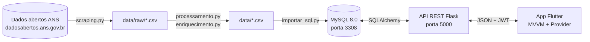
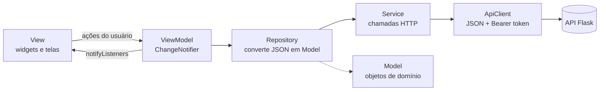

# Intuitive Care — Plataforma de Análise e Gestão de Dados da ANS

Sistema computacional completo composto por **Aplicativo Flutter (Arquitetura MVVM + Provider, web desktop e mobile)**, **API REST em Python + Flask (Arquitetura em Camadas)**, **Pipeline ETL em Python com dados reais da ANS** e **Banco de Dados Relacional MySQL 8.0**.

Projeto desenvolvido e migrado para atender rigorosamente às diretrizes da **2ª Avaliação** das disciplinas de **Códigos de Alta Performance (Mobile)** e **Backend Frameworks** — Curso de Graduação em Ciências da Computação (UNINASSAU João Pessoa).

---

## Sumário das Mudanças Realizadas na Migração

A tabela abaixo compara o estado **antigo (legado)** do projeto com o que está **100% implementado e ativo na versão atual**:

| Funcionalidade / Camada | Como era no Projeto Antigo (Antes) | Como está no Projeto Atual (Agora) |
| :--- | :--- | :--- |
| **Autenticação & Controle de Sessão** | ❌ **Inexistente no projeto original** (não havia login, senhas nem usuários; rotas eram abertas). | ✅ **100% Implementado e Ativo:**<br>• Cadastro (`POST /api/auth/register`) com senha criptografada em hash seguro.<br>• Login (`POST /api/auth/login`) com validação no backend e emissão de JWT.<br>• Identificação do usuário logado via JSON (`GET /api/auth/me`).<br>• Atualização de perfil (`PUT /api/auth/me`): nome, e-mail, cargo, telefone, data de nascimento, foto (JPG/PNG até 2 MB) e preferências.<br>• Logoff com revogação no banco (`POST /api/auth/logout` invalida a sessão em `sessoes_tokens`).<br>• Redefinição de senha por link enviado por e-mail (`POST /api/auth/esqueci-senha` e `POST /api/auth/redefinir-senha`). |
| **Perfis de Acesso** | ❌ Inexistentes. | ✅ **ADMIN** (leitura + escrita + exportação) e **COLABORADOR** (somente leitura + exportação). Toda rota de escrita exige ADMIN (`HTTP 403` para o Colaborador), e operadoras inativas só aparecem para o Administrador. Veja [Perfis de acesso](#perfis-de-acesso). |
| **Frontend** | ❌ Aplicação Web legada em Vue.js 3 + Tailwind CSS (`web-app/` e `frontend/index.html`). | ✅ **100% Migrado para Flutter** (`frontend/`, foco em web desktop) em **MVVM** (`models`, `views`, `viewmodels`, `services`, `repositories`) com **Provider** e rotas via **go_router**. Visual fiel ao **Design System Intuitive Care** (`frontend/web/design-system.html`): Página inicial, Login, Painel Geral, Operadoras ANS, Despesas Contábeis e Configurações de Perfil. |
| **Arquitetura do Backend** | ❌ Script monolítico em arquivo único `api/main_api.py` com apenas 4 endpoints `GET`. | ✅ **100% Reestruturado em Camadas** (`backend/`): separação clara em **Rotas (`routes/`)**, **Regras de Negócio e Validações (`services/`)**, **Persistência (`repositories/`)**, **Modelos (`models/`)** e **Banco (`database/`)**. |
| **Operações HTTP & CRUD** | ❌ Somente leitura (`GET`). | ✅ **CRUD Completo (`GET`, `POST`, `PUT`, `PATCH`, `DELETE`)** em `operadoras`, `despesas` e no perfil de `usuarios`, mais endpoints analíticos (painel, plano de contas, auditoria de lotes e exportação CSV). |
| **Regras de Negócio** | ❌ Quase inexistentes (lógicas soltas na interface). | ✅ **Centralizadas e validadas no Backend**: dígito verificador do CNPJ (módulo 11), validação das 27 UFs, unicidade cadastral, bloqueio de integridade referencial ao excluir operadora com despesas (`HTTP 409`), status da operadora (Ativa / Em análise / Inativa), sinistralidade, ticket médio por vida e variação entre trimestres. |
| **Banco de Dados & ETL** | ❌ Carga ETL sobrescrevia tabelas apagando chaves (`if_exists='replace'`); sem backup SQL; dados de exemplo. | ✅ **Schema relacional com integridade e FKs** (`backend/database/schema.sql`, com migração automática em `init_db.py`), backup demonstrativo (`backend/database/backup_intuitive_care.sql`) e **pipeline ETL com dados reais da ANS**: demonstrações contábeis trimestrais (contas 31, 41, 43 e 46), operadoras ativas e canceladas e beneficiários por operadora. A carga é idempotente e corrige textos com acentuação quebrada. |

---

## Arquitetura

### Visão geral



O banco de dados é a **fonte da verdade**: todos os números exibidos no app (KPIs, gráficos, ranking, plano de contas, status e beneficiários) vêm do MySQL pela API. Nenhum valor fica fixo no código.

### Frontend em MVVM

Cada camada só conversa com a vizinha. As telas (Views) não fazem requisições HTTP: elas observam um ViewModel, que pede os dados a um Repository, que usa um Service para falar com a API.



| Camada | Pasta | Responsabilidade | Exemplos |
| :--- | :--- | :--- | :--- |
| **Model** | `lib/models/` | Objetos de domínio imutáveis, com `fromJson`/`toJson` | `UserModel`, `PreferenciasModel`, `OperadoraModel`, `PainelModel`, `ContasModel` |
| **View** | `lib/views/` | Telas e layout. Leem o estado com `context.watch` e disparam ações no ViewModel | `HomeView`, `LoginView`, `AppShell`, `PainelView`, `OperadorasView`, `DespesasView`, `PerfilView` |
| **ViewModel** | `lib/viewmodels/` | Estado da tela, filtros, carregamento e erros. Avisa a View com `notifyListeners()` | `AuthViewModel`, `PainelViewModel`, `OperadorasViewModel`, `ContasViewModel` |
| **Repository** | `lib/repositories/` | Ponte entre ViewModel e Service: converte respostas em Models | `AuthRepository`, `OperadoraRepository`, `AnaliticoRepository` |
| **Service** | `lib/services/` | Chamadas HTTP de cada recurso da API e cliente JSON centralizado | `ApiClient`, `AuthService`, `OperadoraService`, `AnaliticoService` |
| **Design System** | `lib/shared/` + `lib/app/theme.dart` | Componentes, gráficos, marca, formatação e exportação reutilizados por todas as telas | `AppButton`, `KpiCard`, `PillBarChart`, `Donut`, `Mark`, `Exporter` |

Fluxo de exemplo (filtrar o Painel por UF):

1. O usuário escolhe "SP" no filtro da `PainelView`.
2. A View chama `PainelViewModel.carregar(uf: 'SP')`.
3. O ViewModel marca `isLoading`, chama `AnaliticoRepository.painel(...)`, que chama `AnaliticoService.fetchPainel(...)` (`GET /api/painel?uf=SP`).
4. A resposta vira um `PainelModel`, o ViewModel guarda o resultado e chama `notifyListeners()`.
5. A View é reconstruída com os novos KPIs, ranking e gráfico.

### Backend em camadas

| Camada | Pasta | Responsabilidade |
| :--- | :--- | :--- |
| Rotas | `backend/routes/` | Blueprints REST, leitura de parâmetros e middlewares `@token_required` e `@admin_required` |
| Serviços | `backend/services/` | Regras de negócio e validações (CNPJ, UF, perfis, indicadores, e-mail) |
| Repositórios | `backend/repositories/` | SQL parametrizado (proteção contra SQL injection) |
| Modelos | `backend/models/` | Objetos de domínio e serialização JSON |
| Banco | `backend/database/` | Conexão, schema, migração automática e contas de demonstração |

---

## Perfis de Acesso

Existem dois perfis. **Os dois veem os mesmos dados; só o Administrador pode alterá-los.** O Colaborador consulta e exporta. No protótipo de design, o Colaborador aparece com o nome antigo, "Consumidor".

### Regras por permissão

As regras ficam em um único arquivo, [backend/models/permissoes.py](backend/models/permissoes.py). A API usa esse arquivo para liberar ou bloquear cada ação, e o banco recebe uma cópia dele a cada inicialização.

| Permissão | O que libera | No banco | Admin | Colaborador |
| :--- | :--- | :--- | :---: | :---: |
| `painel.ver` | Ver o painel e seus indicadores | `SELECT` | ✅ | ✅ |
| `operadoras.ver` | Listar e consultar operadoras ativas | `SELECT` | ✅ | ✅ |
| `despesas.ver` | Consultar despesas e contas do setor | `SELECT` | ✅ | ✅ |
| `dados.exportar` | Exportar em CSV, PDF ou XLSX | `SELECT` | ✅ | ✅ |
| `perfil.editar_proprio` | Editar os próprios dados, foto e preferências | `UPDATE` só no próprio usuário | ✅ | ✅ |
| `operadoras.ver_inativas` | Ver operadoras inativas | `SELECT` | ✅ | ❌ |
| `operadoras.criar` | Cadastrar operadora | `INSERT` | ✅ | ❌ |
| `operadoras.editar` | Editar dados de operadora | `UPDATE` | ✅ | ❌ |
| `operadoras.alterar_status` | Inativar ou reativar operadora | `UPDATE` | ✅ | ❌ |
| `operadoras.excluir` | Excluir operadora | `DELETE` | ✅ | ❌ |
| `despesas.criar` | Lançar despesa | `INSERT` | ✅ | ❌ |
| `despesas.editar` | Editar despesa | `UPDATE` | ✅ | ❌ |
| `despesas.excluir` | Excluir despesa | `DELETE` | ✅ | ❌ |
| `lotes.auditar` | Marcar lote contábil como auditado | `UPDATE` | ✅ | ❌ |

### O que cada perfil vê nas telas

| Tela | Administrador | Colaborador |
| :--- | :--- | :--- |
| Painel | Despesas processadas pela pipeline, registros extraídos e operadoras ativas | Despesas médico-hospitalares, sinistralidade e beneficiários, com o aviso "Modo consulta · somente leitura" |
| Operadoras | "Nova operadora", "Exportar CSV" e operadoras inativas na lista | "Exportar"; operadoras inativas ficam ocultas |
| Ficha da operadora | "Gerenciar", com edição e "Inativar/Reativar" | "Detalhes", "Exportar ficha (PDF)" e o aviso "Edição apenas para Administrador" |
| Despesas | "Exportar relatório" e "Auditar lote" | Só "Exportar relatório" |
| Perfil | Selo `ADMIN` em Forest | Selo `COLABORADOR` em Sage |

Ações que o perfil não pode executar **não aparecem** na tela; não ficam apenas desabilitadas.

### Onde a regra é aplicada

1. **Banco de dados**
   - `perfis_acesso`: os perfis existentes (`ADMIN`, `COLABORADOR`), com nome e descrição.
   - `permissoes_perfil`: cada permissão concedida a cada perfil. É regravada a partir do `permissoes.py` em toda inicialização, então não deve ser editada à mão.
   - `usuarios.perfil`: no MySQL/TiDB, só aceita perfis cadastrados em `perfis_acesso` (chave estrangeira `fk_usuario_perfil`). Novos cadastros entram como `COLABORADOR`.
2. **API:** cada rota de escrita declara a permissão exigida com `@permissao_required("...")` e devolve `HTTP 403` para quem não a tem, mesmo que a rota seja chamada direto.
3. **App:** `GET /api/auth/me` devolve a lista `permissoes` do usuário, disponível em `UserModel.pode("...")`. Esconder um botão é só conveniência: a proteção real está na API.

**Para promover um usuário a Administrador:** `UPDATE usuarios SET perfil = 'ADMIN' WHERE email = '...';` A mudança vale no próximo login.

**Para consultar as regras no banco:**
```sql
SELECT p.nome AS perfil, pp.permissao, pp.descricao
FROM permissoes_perfil pp JOIN perfis_acesso p ON p.perfil = pp.perfil
ORDER BY p.perfil, pp.permissao;
```

### Contas de demonstração

Criadas automaticamente pela API na inicialização (`backend/database/init_db.py`). Na tela de login, em modo de desenvolvimento, o bloco "Acessos de demonstração" preenche os campos com um clique.

| Perfil | E-mail | Senha |
| :--- | :--- | :--- |
| Administrador | `admin@intuitivecare.com.br` | `Admin@2025` |
| Colaborador | `colaborador@intuitivecare.com.br` | `Colaborador@2025` |

---

## Telas do Aplicativo

| Rota | Tela | Acesso | O que mostra |
| :--- | :--- | :--- | :--- |
| `/` | Página inicial | Público | Logo em destaque, proposta de valor, benefícios e botão "Design System" |
| `/login` | Login | Público | Painel Forest (desktop) + formulário com validação, mostrar/ocultar senha e erros com `role="alert"` |
| `/painel` | Painel Geral | Autenticado | **Admin:** total de despesas, registros extraídos, operadoras ativas, evolução em 8 trimestres e distribuição por modalidade. **Colaborador:** filtros (UF, Ano, Trimestre, Modalidade), despesas médico-hospitalares, sinistralidade, beneficiários, ticket médio, ranking e série |
| `/operadoras` | Operadoras ANS | Autenticado | Resumo (ativas, em análise, inativadas, beneficiários), busca, filtro, tabela paginada e gaveta de detalhes/edição |
| `/despesas` | Despesas Contábeis | Autenticado | Contas 41, 46 e 43 com variação, plano de contas com comparativo, composição médico-hospitalar, destaques e auditoria de lote |
| `/perfil` | Configurações de Perfil | Autenticado | Foto com prévia, dados pessoais, preferências (idioma, data, exportação, UF e trimestre padrão, tema, avisos) e encerrar sessão com confirmação |

---

## Explorar Dados (Self-Service Analytics)

Tela `/explorar`, disponível para Administrador e Colaborador. Todos os números vêm do banco, por `GET /api/explorar`.

| Recurso | Como funciona |
| :--- | :--- |
| **Período por anos** | Quatro modos: um **Ano**, um **Intervalo** (de/até), os **Últimos N anos** ou **Anos específicos**, marcando quantos anos quiser, mesmo fora de sequência (ex.: 2019, 2021 e 2024). A série pode ser **por ano** ou **por trimestre**. Com **Comparar com período anterior**, os KPIs mostram a variação e a linha de evolução ganha a série anterior em Mint tracejado. |
| **Construtor de gráficos** | Até 8 cartões, cada um com um **tipo** (`pill_bar`, `donut_sage`, `trend_area`, `horizontal_ranking`) e uma **métrica** (despesas, receitas, sinistralidade, beneficiários). O layout fica salvo nas preferências do perfil (`graficos_explorar`). |
| **Filtros avançados** | Facetas reais do dataset, todas com múltipla escolha: modalidade, UF, porte da ANS por beneficiários, faixa de despesa no período e status de consolidação (lote auditado ou pendente). O Admin também filtra pelo status da operadora. Os filtros ativos aparecem como pílulas removíveis e valem para KPIs, gráficos e listagem. |
| **Listagem detalhada** | Operadoras do recorte, ordenáveis por métrica e paginadas. O clique abre a operadora, e o botão **Exportar** da Topbar baixa o recorte. |

**Regras dos números**
- **Sinistralidade:** é calculada como despesas ÷ receitas do conjunto, não como média de razões. Por isso não entra no gráfico de rosca, já que razões não se somam.
- **Beneficiários:** usam o último trimestre do recorte.
- **Anos parciais:** anos com menos de 4 trimestres publicados aparecem com `*`.
- **Trimestre:** sempre por extenso ("1º trimestre" / "2026"), nunca abreviado como "1T26".
- **Anos disponíveis:** dependem do ETL. Para ter mais histórico, rode `python etl/scraping.py --anos 5` e reprocesse.

## Critérios de Aceite do MVP

| # | Critério | Status | Como foi verificado |
| :---: | :--- | :---: | :--- |
| 1 | Página inicial sem números, com logo em destaque e botão "Design System" no canto superior direito | ✅ | `HomeView` + teste `responsivo_test.dart` |
| 2 | Login autentica e redireciona para `/painel`; erros exibidos corretamente | ✅ | `LoginView` + `viewmodels_test.dart` + teste manual no navegador |
| 3 | Sidebar só com MENU e CONTA; sem Engenharia, sem widget de API, sem sino | ✅ | `AppShell` |
| 4 | Admin vê e usa: Nova operadora, Gerenciar/Editar, Inativar/Reativar, Auditar lote | ✅ | `OperadorasView`, `DespesasView` + `test_painel_contas_e_auditoria` |
| 5 | Colaborador **não vê** nenhuma ação de escrita e não vê operadoras inativas | ✅ | Telas + `test_colaborador_somente_leitura` e `test_inativas_visiveis_somente_para_admin` |
| 6 | Filtros de período sempre em dois campos (Ano + Trimestre), sem "4T25" em nenhum lugar | ✅ | `fmtPeriodo`/`fmtPeriodoCurto` + `models_test.dart` + busca no código |
| 7 | Busca de operadoras por Registro ANS, razão social, nome fantasia e CNPJ (com ou sem máscara) | ✅ | `OperadoraRepository._filtros` + `test_busca_cnpj_com_mascara` |
| 8 | Perfil: troca de foto com prévia, edição de dados, preferências e salvar com toast | ✅ | `PerfilView` + `test_perfil_preferencias_e_foto` |
| 9 | "Encerrar sessão" pede confirmação e volta para `/login` | ✅ | `PerfilView` (confirmação em dois passos) |
| 10 | Wordmark "intuitivecare" inteiro em `#113E32` em todos os fundos claros | ✅ | `LogoHorizontal` / `AppColors.forest` |
| 11 | Página inicial e login sem rolagem horizontal em 360px | ✅ | `responsivo_test.dart` (falha se houver qualquer overflow em 360px e 1440px) |

---

## Estrutura de Diretórios

```text
intuitive_care/
├── backend/
│   ├── app.py                          # Application Factory Flask, CORS e tratamento global de erros
│   ├── config.py                       # Configurações de BD (MySQL/SQLite), JWT e provedores de e-mail
│   ├── requirements.txt                # Dependências isoladas do backend
│   ├── Dockerfile                      # Container da API Flask
│   ├── .env.example                    # Modelo de variáveis de ambiente
│   ├── database/
│   │   ├── connection.py               # Gerenciamento de conexões SQLAlchemy/PyMySQL
│   │   ├── schema.sql                  # DDL oficial MySQL 8.0 com FKs e índices
│   │   ├── backup_intuitive_care.sql   # Exportação SQL completa (estrutura + relacionamentos + dados)
│   │   └── init_db.py                  # Inicialização programática do banco e seed inicial
│   ├── models/                         # Modelos de domínio (Usuario + preferências, Operadora, Despesa)
│   ├── repositories/                   # Persistência SQL parametrizada (inclui analitico_repository.py)
│   ├── services/                       # Regras de negócio, validadores, auth JWT, e-mail e indicadores
│   ├── routes/                         # Blueprints REST e middlewares @token_required / @admin_required
│   └── tests/                          # Suíte automatizada de testes de integração da API
├── etl/                                # Pipeline ETL com dados abertos da ANS
│   ├── scraping.py                     # Baixa demonstrações contábeis, operadoras ativas/canceladas e beneficiários
│   ├── processamento.py                # Contas 31/41/43/46 por operadora e do setor (valor do trimestre = final − inicial)
│   ├── enriquecimento.py               # Cruzamento com Relatorio_cadop.csv e agregação estatística
│   ├── importar_sql.py                 # Carga idempotente no MySQL preservando PK/FK
│   ├── texto.py                        # Leitura UTF-8/latin1 e correção de acentuação quebrada
│   └── queries_analiticas.py           # Consultas analíticas SQL sobre a base ANS
├── frontend/                           # Aplicativo Flutter (MVVM + Provider), foco em web desktop
│   ├── pubspec.yaml                    # provider, http, go_router, google_fonts, lucide_icons, pdf, excel...
│   ├── web/design-system.html          # Design System Intuitive Care (aberto pelo botão "Design System")
│   ├── lib/
│   │   ├── main.dart                   # Injeção de dependências via MultiProvider
│   │   ├── app/                        # Tema (tokens de cor, tipografia, sombras) e rotas (go_router)
│   │   ├── config/api_config.dart      # URL base da API Flask (emulador Android / desktop / web)
│   │   ├── models/                     # UserModel, OperadoraModel, PainelModel, ContasModel
│   │   ├── services/                   # Comunicação HTTP/JSON com a API Flask (ApiClient + services)
│   │   ├── repositories/               # Intermediação entre ViewModels e Services
│   │   ├── viewmodels/                 # Auth, Painel, Operadoras e Contas
│   │   ├── views/                      # Início, Login, AppShell, Painel, Operadoras, Despesas e Perfil
│   │   └── shared/                     # Componentes do Design System (ui/), gráficos (charts/), marca (brand/) e utilitários (utils/)
│   └── test/                           # Testes de modelos, formatação, ViewModels e responsividade (360px/1440px)
├── docs/
│   ├── PLANO_DE_ATAQUE.md              # Plano de ataque da migração e checklist acadêmico
│   └── RELATORIO_TECNICO.md            # Relatório Técnico completo (Seção 4.3)
├── utils/
│   ├── corrigir_encoding.py            # Corrige acentuação quebrada já gravada no banco
│   ├── criar_tabelas_docker.py         # Inicializa schema e massa demonstrativa no MySQL Docker
│   ├── gerar_entregavel_backend.py     # Gera .zip do backend + backup SQL para entrega acadêmica
│   ├── verificar.py
│   └── verificar_banco.py
├── docker-compose.yml                  # Orquestração MySQL 8.0 + API Flask
├── intuitive_care_collection.json      # Coleção Postman atualizada (Auth + CRUD + Estatísticas)
├── queries_analiticas.sql
└── requirements.txt
```

---

## Principais Endpoints da API REST (Flask)

Todas as requisições e respostas utilizam **JSON**. Rotas protegidas exigem cabeçalho `Authorization: Bearer <token>`. Rotas marcadas com **(ADMIN)** devolvem `HTTP 403` para o perfil Colaborador.

| Grupo | Método | Rota | Descrição |
| :--- | :--- | :--- | :--- |
| **Saúde** | `GET` | `/api/health` | Verifica status da API e conectividade com o SGBD |
| **Auth** | `POST` | `/api/auth/register` | Cadastro de usuário (perfil COLABORADOR) com e-mail, nome e senha |
| **Auth** | `POST` | `/api/auth/login` | Autenticação por e-mail/senha e emissão de JWT |
| **Auth** | `GET` | `/api/auth/me` | Retorna dados, perfil e preferências do usuário autenticado |
| **Auth** | `PUT` | `/api/auth/me` | Atualiza nome, e-mail, cargo, telefone, nascimento, foto e preferências |
| **Auth** | `POST` | `/api/auth/logout` | Encerra sessão revogando o token no banco de dados |
| **Auth** | `POST` | `/api/auth/esqueci-senha` | Envia o link de redefinição, com resposta igual para e-mail existente ou não (limite: 3 pedidos a cada 15 min) |
| **Auth** | `POST` | `/api/auth/redefinir-senha` | Valida o token de uso único, troca a senha e encerra as sessões |
| **Painel** | `GET` | `/api/painel` | KPIs, série trimestral, modalidades e ranking (`ano`, `trimestre`, `uf`, `modalidade`) |
| **Contas** | `GET` | `/api/contas` | Plano de contas ANS do setor com comparação ao trimestre anterior (`ano`, `trimestre`, `grupo`) |
| **Contas** | `POST` | `/api/contas/lotes/<ano>/<trimestre>/auditar` | Marca o lote do trimestre como auditado **(ADMIN)** |
| **Operadoras** | `GET` | `/api/operadoras` | Lista paginada com busca (Registro ANS, razão social, nome fantasia ou CNPJ com/sem máscara) e filtros `uf`, `modalidade`, `status` |
| **Operadoras** | `GET` | `/api/operadoras/resumo` | Ativas, em análise, inativadas em 12 meses, beneficiários, modalidades e UFs |
| **Operadoras** | `GET` | `/api/operadoras/exportar.csv` | Exporta a lista filtrada em CSV (Admin e Colaborador; inativas só para o Admin) |
| **Operadoras** | `GET` | `/api/operadoras/<id>` | Detalha operadora por `registro_ans` ou `cnpj` |
| **Operadoras** | `GET` | `/api/operadoras/<id>/despesas` | Lista despesas da operadora |
| **Operadoras** | `POST` | `/api/operadoras` | Cadastra nova operadora (valida CNPJ e UF no backend) **(ADMIN)** |
| **Operadoras** | `PUT` | `/api/operadoras/<id>` | Atualiza dados cadastrais da operadora **(ADMIN)** |
| **Operadoras** | `PATCH` | `/api/operadoras/<id>/status` | Inativa, reativa ou coloca em análise **(ADMIN)** |
| **Operadoras** | `DELETE` | `/api/operadoras/<id>` | Exclui operadora (bloqueia se houver despesas sem `?force=true`) **(ADMIN)** |
| **Despesas** | `GET` | `/api/despesas` | Lista despesas paginadas com filtros (`reg_ans`, `ano`, `trimestre`, `semestre`) |
| **Despesas** | `GET` | `/api/despesas/anos` | Anos com despesas carregadas |
| **Despesas** | `GET` | `/api/despesas/<id>` | Detalha lançamento de despesa |
| **Despesas** | `POST` | `/api/despesas` | Lança nova despesa vinculada a uma operadora válida **(ADMIN)** |
| **Despesas** | `PUT` | `/api/despesas/<id>` | Atualiza lançamento de despesa **(ADMIN)** |
| **Despesas** | `DELETE` | `/api/despesas/<id>` | Exclui lançamento de despesa **(ADMIN)** |
| **Estatísticas** | `GET` | `/api/estatisticas` | Indicadores legados: total geral, média, Top 5 UFs e Top operadoras |

---

## Como Executar o Projeto

### 1. Pré-requisitos

- **Python 3.11+**
- **Flutter SDK 3.x+**
- **Docker & Docker Compose** (ou instância local de **MySQL 8.0**)

### 2. Configurando o `.env`

Crie um arquivo `.env` na raiz do projeto, a partir de `backend/.env.example`. A API e o ETL leem esse arquivo automaticamente, e ele não é versionado. Cada linha deve seguir o formato `NOME=valor`, sem espaços no nome:

```env
DB_ENGINE=mysql
DB_HOST=127.0.0.1
DB_PORT=3308
DB_USER=root
DB_PASSWORD=sua_senha_do_mysql
DB_NAME=intuitive_care
```

### 3. Subindo Backend + Banco MySQL com Docker

```bash
docker-compose up --build -d
```

- O MySQL 8.0 sobe na porta **`3308`** (mapeada para `3306` interna) e executa automaticamente `backend/database/backup_intuitive_care.sql` na primeira inicialização.
- A API Flask fica disponível em **`http://localhost:5000`** e usa a senha do banco definida no `.env`.
- Ao iniciar, a API cria as tabelas novas e garante as contas de demonstração:

| Perfil | E-mail | Senha |
| :--- | :--- | :--- |
| Administrador | `admin@intuitivecare.com.br` | `Admin@2025` |
| Colaborador | `colaborador@intuitivecare.com.br` | `Colaborador@2025` |

### 4. Executando o Backend Localmente (sem Docker)

```bash
pip install -r backend/requirements.txt
# Opcional para modo demonstração local com SQLite (no PowerShell: $env:DB_ENGINE = "sqlite"):
set DB_ENGINE=sqlite
python -m backend.app
```

### 5. Carregando os Dados Reais da ANS (Pipeline ETL)

```bash
pip install -r requirements.txt
python etl/scraping.py --anos 3   # demonstrações contábeis + operadoras ativas/canceladas + beneficiários
python etl/processamento.py       # contas 31/41/43/46 por operadora, plano de contas do setor e lotes
python etl/enriquecimento.py
python etl/importar_sql.py        # carga idempotente no MySQL (usa as variáveis DB_* do .env)
```

Fontes: `dadosabertos.ans.gov.br/FTP/PDA/` (`demonstracoes_contabeis`, `operadoras_de_plano_de_saude_ativas`, `operadoras_de_plano_de_saude_canceladas` e `beneficiarios_vinculos_tipo_contratacao_vda`). O valor de cada trimestre é `VL_SALDO_FINAL − VL_SALDO_INICIAL`, porque a DRE da ANS acumula os saldos ao longo do ano.

Para corrigir acentuação quebrada já gravada no banco: `python utils/corrigir_encoding.py`.

### 6. Executando o Aplicativo Flutter

```bash
cd frontend
flutter pub get
# Navegador (recomendado: telas desktop a partir de 1280px). Em localhost, usa http://localhost:5000/api automaticamente:
flutter run -d chrome

# Emulador Android (usa http://10.0.2.2:5000/api automaticamente):
flutter run

# Ou especificar a API manualmente (ex.: dispositivo físico na mesma rede):
flutter run --dart-define=API_URL=http://192.168.0.10:5000/api
```

Rotas do app: `/` (início), `/login`, `/cadastro`, `/esqueci-senha`, `/redefinir-senha`, `/painel`, `/operadoras`, `/despesas` e `/perfil`. As rotas autenticadas redirecionam para `/login` quando não há sessão.

### 7. Executando Testes Automatizados

**Backend (Python unittest):**
```bash
python -m unittest discover -s backend/tests -v
```

**Frontend (Flutter test & analyze):**
```bash
cd frontend
flutter analyze
flutter test
```

### 8. Gerando o Pacote Compactado do Backend + SQL (Seção 4.2)

```bash
python utils/gerar_entregavel_backend.py
```

O arquivo `dist/intuitive_care_backend_e_sql.zip` será gerado contendo o código-fonte completo do backend, ETL, `backup_intuitive_care.sql` e arquivos de configuração.

---

## Cadastro e Redefinição de Senha

- **Cadastro (`/cadastro`):** nome, e-mail, cargo opcional, senha e aceite dos termos. A conta nasce como Colaborador e o usuário segue para o login com o e-mail preenchido.
- **Regra de senha:** mínimo de 8 caracteres, com letra maiúscula, número e símbolo.
- **Redefinição (`/esqueci-senha` → e-mail → `/redefinir-senha?token=...`):** o link vale por `RESET_TOKEN_EXPIRA_MIN` minutos e só pode ser usado uma vez. Pedir um novo link invalida o anterior, e concluir a troca encerra todas as sessões do usuário.
- **Segurança:** o banco guarda apenas o hash do token, e a resposta do pedido é a mesma para e-mails cadastrados ou não.

### Configuração no `.env`

```env
RESET_TOKEN_EXPIRA_MIN=30
FRONTEND_URL=http://localhost:8080
MAIL_MODO=smtp            # smtp | console | resend | brevo
MAIL_HOST=mailpit
MAIL_PORT=1025
MAIL_USER=
MAIL_PASSWORD=
MAIL_FROM=
```

Com `docker compose up -d`, os e-mails ficam em **http://localhost:8025** (Mailpit). Com `MAIL_MODO=console`, o link aparece no log da API. Depois de mudar o `.env`, rode `docker restart intuitive_care-api-1`.

### Roteiro de QA
| # | Cenário | Esperado |
|---|---|---|
| 1 | Cadastro válido | Toast, redirecionamento ao login e perfil COLABORADOR |
| 2 | E-mail já cadastrado | Erro inline sem perder o formulário |
| 3 | Senha fraca ou confirmação diferente | Botão desabilitado e mensagem |
| 4 | Cadastro em 360px | Sem rolagem horizontal |
| 5 | Reset com e-mail existente | E-mail chega no Mailpit |
| 6 | Reset com e-mail inexistente | Mesma resposta, nenhum e-mail enviado |
| 7 | Link válido | Senha trocada e login com a senha nova |
| 8 | Reusar o link | "Link já utilizado" |
| 9 | Link expirado (`RESET_TOKEN_EXPIRA_MIN=1`) | "Link expirado" |
| 10 | Sessão aberta antes do reset | Derrubada, pede login de novo |
| 11 | 4 pedidos seguidos | O 4º é bloqueado pelo limite de tentativas |
| 12 | Admin redefine a senha | Continua com perfil e acessos de ADMIN |

---

## Documentação Complementar

- [Plano de Ataque da Migração](docs/PLANO_DE_ATAQUE.md)
- [Relatório Técnico Completo (Seção 4.3)](docs/RELATORIO_TECNICO.md)
