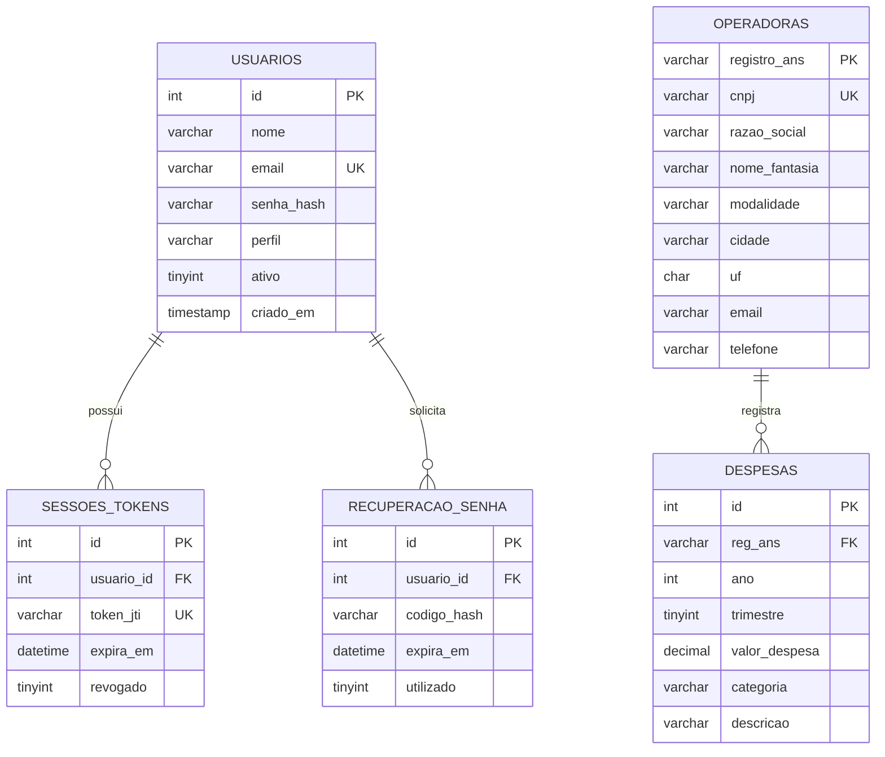

# Relatório Técnico — Projeto Intuitive Care

**Instituição:** Centro Universitário Maurício de Nassau de João Pessoa (UNINASSAU)  
**Curso:** Graduação em Ciências da Computação  
**Disciplinas:** Códigos de Alta Performance (Mobile) / Backend Frameworks — 2ª Avaliação  
**Repositório:** https://github.com/luizaleblanc/intuitive_care

---

## 1. Justificativa do Tema Escolhido

O setor de saúde suplementar brasileiro movimenta bilhões de reais por trimestre sob regulação da **Agência Nacional de Saúde Suplementar (ANS)**. Os dados contábeis e cadastrais das operadoras de planos de saúde são públicos, porém disponibilizados em arquivos compactados heterogêneos (CSVs com diferentes codificações e estruturas), o que dificulta a análise ágil por gestores, auditores e pesquisadores.

O tema **Intuitive Care** foi escolhido por unir um problema real de engenharia de dados na área da saúde com a necessidade prática de consulta, auditoria e gestão cadastral/financeira em mobilidade. Além disso, o reaproveitamento da pipeline ETL em Python já existente permite alimentar o banco relacional com dados reais da ANS e disponibilizar, por meio de uma API REST Flask, um aplicativo móvel Flutter estruturado em MVVM para análise e manipulação completa (CRUD) desses registros.

---

## 2. Descrição do Problema que o Sistema Pretende Solucionar

O sistema resolve três gargalos principais enfrentados na análise de despesas assistenciais da saúde suplementar:

1. **Dispersão e heterogeneidade dos dados da ANS:** A pipeline ETL automatiza a coleta (`scraping.py`), padronização (`processamento.py`), cruzamento cadastral (`enriquecimento.py`) e carga relacional (`importar_sql.py`) no MySQL.
2. **Ausência de controle de acesso e manutenção em API REST segura:** A versão inicial possuía apenas rotas públicas somente-leitura (`GET`), sem autenticação de usuários, sem CRUD completo e sem validação centralizada de regras de negócio no servidor.
3. **Necessidade de cliente mobile desacoplado e manutenível:** A migração do frontend web legado (Vue.js 3) para um aplicativo móvel **Flutter** em arquitetura **MVVM com Provider** permite acesso móvel estruturado, separando responsabilidades entre interface, estado, repositórios e comunicação HTTP/JSON exclusiva com a API Flask.

---

## 3. Descrição dos Requisitos e Funcionalidades Implementadas

### 3.1. Requisitos de Backend (Python + Flask + MySQL)
- **Comunicação 100% REST/JSON:** Todos os endpoints recebem e retornam JSON com códigos de status HTTP semânticos (`200`, `201`, `400`, `401`, `403`, `404`, `409`, `500`, `503`).
- **Autenticação e Controle de Sessão:**
  - Cadastro de usuários com nome, e-mail e senha armazenada com hash `pbkdf2:sha256`.
  - Login com validação de credenciais no backend e emissão de token JWT (`HS256`) vinculado à tabela `sessoes_tokens`.
  - Consulta e atualização do usuário autenticado via JSON (`/api/auth/me`).
  - Logoff (`POST /api/auth/logout`) com revogação efetiva do token (`revogado = 1`) no banco de dados.
  - Recuperação de senha por e-mail (`/api/auth/forgot-password` e `/api/auth/reset-password`) integrada a `EmailService` (suporte a APIs REST Resend/Brevo, SMTP ou modo demonstração local).
- **CRUD Completo nas Principais Tabelas:**
  - `operadoras`: listagem paginada com busca textual e filtro por UF (`GET`), detalhamento (`GET`), cadastro (`POST`), atualização (`PUT`) e exclusão (`DELETE`).
  - `despesas`: listagem paginada com filtros por operadora, ano e trimestre (`GET`), detalhamento (`GET`), lançamento (`POST`), atualização (`PUT`) e exclusão (`DELETE`).
- **Regras de Negócio Centralizadas no Servidor:**
  - Validação algorítmica de CNPJ (14 dígitos + dígitos verificadores módulo 11) e unicidade de CNPJ e Registro ANS.
  - Validação das 27 siglas de UF brasileiras, formato de e-mail, ano (`2000` até ano atual + 1), trimestre (`1..4`) e valor positivo.
  - Bloqueio de exclusão de operadora com despesas vinculadas (`HTTP 409 Conflict`), exigindo confirmação explícita em cascata (`?force=true`).
  - Classificação automática do porte financeiro do lançamento (`Pequeno Porte`, `Médio Porte`, `Grande Porte`) e cálculo de indicadores agregados (`top_ufs`, `serie_trimestral`, `crescimento_periodo_pct`) exclusivamente no backend.

### 3.2. Requisitos do Aplicativo Mobile (Flutter + MVVM + Provider)
- **Telas de Autenticação:** Login, Cadastro de Usuário e Recuperação de Senha em duas etapas (envio do código e redefinição).
- **Tela Principal (Painel Geral):** Saudação personalizada ao usuário autenticado, KPIs consolidados, gráfico de barras do Top 5 UFs e evolução trimestral.
- **Telas CRUD de Operadoras e Despesas:** Listagem paginada com busca/filtros, tela de detalhes da operadora com histórico de despesas, formulários de criação/edição e exclusão com confirmação.
- **Tela do Usuário Autenticado (Perfil):** Exibição dos dados retornados por `GET /api/auth/me`, edição de nome (`PUT /api/auth/me`) e encerramento de sessão (`POST /api/auth/logout`).
- **Tratamento de Erros e Respostas:** Banners e diálogos exibindo mensagens reais retornadas pela API Flask e redirecionamento automático ao login em caso de erro `401`.

---

## 4. Modelo do Banco de Dados e Relacionamentos

O banco relacional MySQL 8.0 (`intuitive_care`) é definido em [`backend/database/schema.sql`](../backend/database/schema.sql) e exportado com massa de dados demonstrativa em [`backend/database/backup_intuitive_care.sql`](../backend/database/backup_intuitive_care.sql).



**Relacionamentos Implementados:**
- `sessoes_tokens.usuario_id` → `usuarios.id` (`ON DELETE CASCADE`)
- `recuperacao_senha.usuario_id` → `usuarios.id` (`ON DELETE CASCADE`)
- `despesas.reg_ans` → `operadoras.registro_ans` (`ON DELETE RESTRICT ON UPDATE CASCADE`)

---

## 5. Descrição dos Principais Endpoints da API

| Endpoint | Métodos | Autenticação | Função |
| :--- | :--- | :--- | :--- |
| `/api/health` | `GET` | Pública | Verifica disponibilidade da API e conexão com o banco |
| `/api/auth/register` | `POST` | Pública | Registra novo usuário e inicia sessão JWT |
| `/api/auth/login` | `POST` | Pública | Valida credenciais e retorna token Bearer + dados do usuário |
| `/api/auth/me` | `GET`, `PUT` | Bearer Token | Consulta ou atualiza dados do usuário autenticado |
| `/api/auth/logout` | `POST` | Bearer Token | Revoga o token da sessão atual na tabela `sessoes_tokens` |
| `/api/auth/forgot-password` | `POST` | Pública | Gera código de 6 dígitos com expiração e dispara e-mail via API |
| `/api/auth/reset-password` | `POST` | Pública | Valida código temporário, atualiza senha e revoga sessões antigas |
| `/api/operadoras` | `GET`, `POST` | Bearer Token | Lista paginada/filtrada ou cadastra nova operadora |
| `/api/operadoras/<id>` | `GET`, `PUT`, `DELETE` | Bearer Token | Consulta, atualiza ou exclui operadora (com regra `force=true`) |
| `/api/operadoras/<id>/despesas` | `GET` | Bearer Token | Lista despesas vinculadas à operadora |
| `/api/despesas` | `GET`, `POST` | Bearer Token | Lista despesas paginadas/filtradas ou lança nova despesa |
| `/api/despesas/<id>` | `GET`, `PUT`, `DELETE` | Bearer Token | Consulta, atualiza ou exclui lançamento de despesa |
| `/api/estatisticas` | `GET` | Bearer Token | Retorna KPIs consolidados, Top 5 UFs e série trimestral |

---

## 6. Comunicação entre Flutter e Flask

Toda comunicação entre o aplicativo Flutter e o servidor ocorre exclusivamente por meio do protocolo **HTTP/REST** com payloads **JSON** (`Content-Type: application/json`), centralizada na classe `ApiClient` (`frontend/lib/services/api_client.dart`):

1. **Resolução de Endpoint (`ApiConfig`):** Utiliza `--dart-define=API_URL` quando informado, `http://10.0.2.2:5000/api` automaticamente no emulador Android e `http://localhost:5000/api` nos demais alvos.
2. **Autenticação Bearer:** Após `POST /api/auth/login` ou `POST /api/auth/register`, o token JWT retornado pelo Flask é injetado no `ApiClient` e enviado no cabeçalho `Authorization: Bearer <token>` em todas as requisições subsequentes.
3. **Tratamento de Respostas e Erros:** Códigos `2xx` são desserializados nos modelos Dart correspondentes; códigos `4xx/5xx` são convertidos em `ApiException` com a mensagem JSON (`erro`) vinda do backend Flask. Respostas `401` acionam o callback `onUnauthorized` no `AuthViewModel`, limpando a sessão local e retornando à `LoginView`.
4. **Proibição de Persistência Substituta:** Não há Firebase nem banco de dados de domínio local; apenas o token de sessão é mantido temporariamente em `SessionStorageService` para restaurar sessão mediante validação obrigatória em `GET /api/auth/me`.

---

## 7. Arquitetura MVVM Utilizada no Aplicativo Flutter

O aplicativo segue estritamente o padrão **Model-View-ViewModel (MVVM)** integrado ao **Provider**:

- **Models (`lib/models/`):** Classes imutáveis (`UserModel`, `OperadoraModel`, `DespesaModel`, `EstatisticaDashboardModel`, `PaginatedResponse`) responsáveis pela representação e conversão `fromJson`/`toJson`.
- **Services (`lib/services/`):** Camada de infraestrutura HTTP (`ApiClient`, `AuthService`, `OperadoraService`, `DespesaService`, `EstatisticaService`, `SessionStorageService`).
- **Repositories (`lib/repositories/`):** Camada intermediária que orquestra os serviços, converte mapas JSON em objetos de domínio e isola a origem de dados dos ViewModels.
- **ViewModels (`lib/viewmodels/`):** Classes que estendem `ChangeNotifier` (`AuthViewModel`, `DashboardViewModel`, `OperadoraViewModel`, `DespesaViewModel`), mantendo estados de carregamento (`isLoading`, `isSubmitting`), erros (`errorMessage`) e dados reativos notificados via `notifyListeners()`.
- **Views (`lib/views/`) e Widgets (`lib/widgets/`):** Camada de apresentação pura em Flutter Material 3, consumindo estado via `context.watch<ViewModel>()` e disparando comandos via `context.read<ViewModel>()`.
- **Injeção de Dependências (`main.dart`):** `MultiProvider` instancia e conecta Services → Repositories → ViewModels → Views.

---

## 8. Estrutura de Diretórios do Frontend e Backend

### Backend (`backend/` e `etl/`)
```text
backend/
├── app.py
├── config.py
├── requirements.txt
├── Dockerfile
├── .env.example
├── database/ (connection.py, schema.sql, backup_intuitive_care.sql, init_db.py)
├── models/ (usuario_model.py, operadora_model.py, despesa_model.py)
├── repositories/ (usuario_repository.py, operadora_repository.py, despesa_repository.py)
├── services/ (auth_service.py, operadora_service.py, despesa_service.py, estatistica_service.py, email_service.py, validators.py)
├── routes/ (decorators.py, health_routes.py, auth_routes.py, operadora_routes.py, despesa_routes.py, estatistica_routes.py)
└── tests/ (test_api.py)
```

### Frontend (`frontend/lib/`)
```text
frontend/lib/
├── main.dart
├── config/ (api_config.dart)
├── models/ (user_model.dart, operadora_model.dart, despesa_model.dart, estatistica_model.dart, paginated_response.dart)
├── services/ (api_client.dart, session_storage_service.dart, auth_service.dart, operadora_service.dart, despesa_service.dart, estatistica_service.dart)
├── repositories/ (auth_repository.dart, operadora_repository.dart, despesa_repository.dart, estatistica_repository.dart)
├── viewmodels/ (auth_viewmodel.dart, dashboard_viewmodel.dart, operadora_viewmodel.dart, despesa_viewmodel.dart)
├── views/ (splash_view.dart, login_view.dart, register_view.dart, forgot_password_view.dart, main_shell_view.dart, dashboard_view.dart, operadoras_list_view.dart, operadora_detail_view.dart, operadora_form_view.dart, despesas_list_view.dart, despesa_form_view.dart, profile_view.dart)
└── widgets/ (app_error_banner.dart, kpi_card.dart, uf_bar_chart.dart, operadora_card.dart, despesa_tile.dart, confirm_delete_dialog.dart, currency_formatter.dart)
```

---

## 9. Registros dos Testes Realizados e Resultados Obtidos

### 9.1. Testes Automatizados da API Flask (`python -m unittest discover -s backend/tests -v`)
Executados utilizando `app.test_client()` com banco relacional completo inicializado via `initialize_database(seed=True)`:

| Caso de Teste | Escopo Validado | Resultado |
| :--- | :--- | :--- |
| `test_health_endpoint` | `GET /api/health` e conectividade com SGBD | **OK** |
| `test_auth_register_login_me_update_logout` | Cadastro (`201`), e-mail duplicado (`409`), `GET/PUT /api/auth/me`, `POST /api/auth/logout` e bloqueio pós-logout (`401`) | **OK** |
| `test_password_recovery_flow` | Geração de código (`POST /api/auth/forgot-password`), validação de código inválido (`400`), redefinição (`POST /api/auth/reset-password`) e login com nova senha | **OK** |
| `test_operadoras_crud_and_business_rules` | Proteção sem token (`401`), paginação, validação de CNPJ e UF (`400`), `POST` (`201`), `PUT` (`200`), bloqueio de exclusão com despesas (`409`) e `DELETE` (`200`) | **OK** |
| `test_despesas_crud_and_statistics` | Validação de operadora inexistente (`404`), trimestre inválido (`400`), `POST`/`PUT`/`DELETE` de despesas, classificação `faixa_porte` e `GET /api/estatisticas` | **OK** |

**Resumo da execução:** `Ran 5 tests in 9.255s — OK`.

### 9.2. Análise Estática e Testes do Aplicativo Flutter
1. **Análise Estática (`flutter analyze` em `frontend/`):**
   - Resultado: `No issues found! (ran in 3.6s)`.
2. **Suíte de Testes (`flutter test` em `frontend/`):**
   - `Models JSON Serialization` (3 testes): desserialização e serialização de `UserModel`, `OperadoraModel`, `DespesaModel` e `EstatisticaDashboardModel`.
   - `ViewModels + Repositories + ApiClient Integration` (2 testes): fluxo completo de login/Bearer/logout no `AuthViewModel` e tratamento de erro HTTP `400` no `OperadoraViewModel` via `MockClient`.
   - `LoginView` widget test (1 teste): renderização dos campos de login e links de cadastro e recuperação de senha.
   - **Resumo da execução:** `All tests passed! (6/6)`.

### 9.3. Verificação do Empacotamento de Entrega (`python utils/gerar_entregavel_backend.py`)
- Arquivo gerado com sucesso em `dist/intuitive_care_backend_e_sql.zip` contendo `backend/` (incluindo `schema.sql` e `backup_intuitive_care.sql`), `etl/`, `docker-compose.yml`, `requirements.txt` e `intuitive_care_collection.json`.
